# Room 44: Gameplay Breakdown

> *Every room is taken. Except one.*

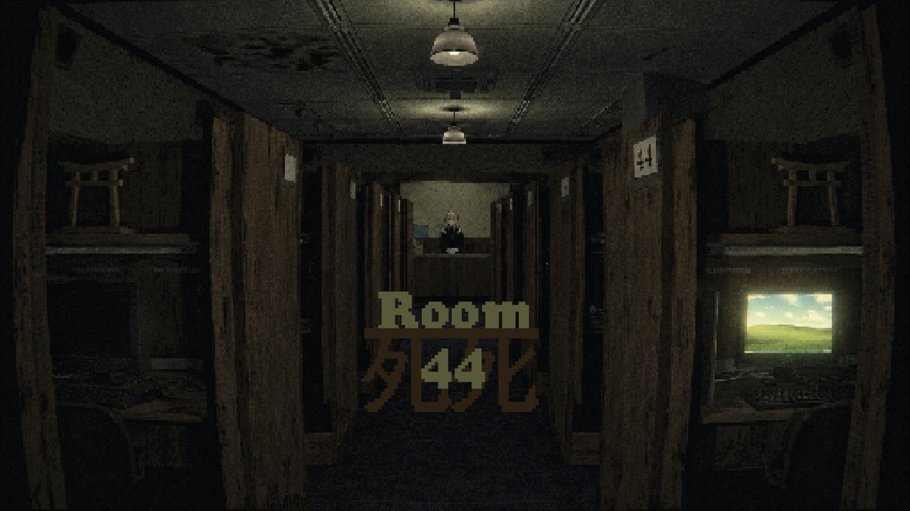

**Genre:** first-person psychological mystery / horror, narrative exploration with a terminal puzzle
**Engine:** Unity **6000.3.10f1**, Built-in Render Pipeline with Post Processing v2

All footage, audio and screenshots were **captured in-engine from the actual game**.

> 🎞️ Every video in this document plays as a silent animated preview. Click a preview to open the full MP4 (with the game's audio).

---

## Development status

This is a **demo**. Everything from the title screen up to entering Room 44 and solving the first puzzle on its computer, which triggers the first jump scare, is complete and playable. What follows the scare (the hostess's explanation and the night after) is the next part in development; the terminal commands listed in section 6 that are not part of the first puzzle (`listen`, `remember`, `restore`, `unzip`…) are implemented in the shell and ready for later content.

---

## 1. How a night unfolds

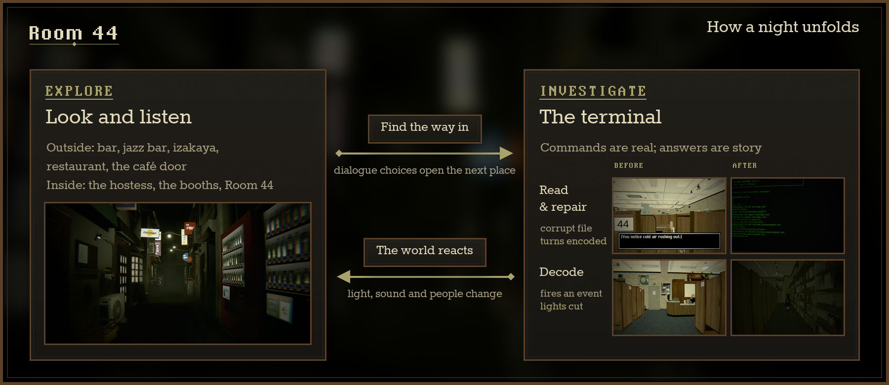

1. **Explore** the street and the café: walk, look, listen. Interaction points react when you are close *and* looking at them.
2. **Talk** your way forward: typewriter dialogue and yes/no choices open the next place (the café, the key, the booth).
3. **Investigate** on the terminal: real commands over a virtual filesystem, with files that are corrupted, encoded or wired to events.
4. **The world reacts**: terminal events reach back into the scene, changing light and sound and moving characters. Repeat.

Terminal progress (filesystem changes, discovered files, flags, event fire counts, command history) is saved to JSON by `TerminalSaveSystem`.

---

## 2. Prologue: the last train

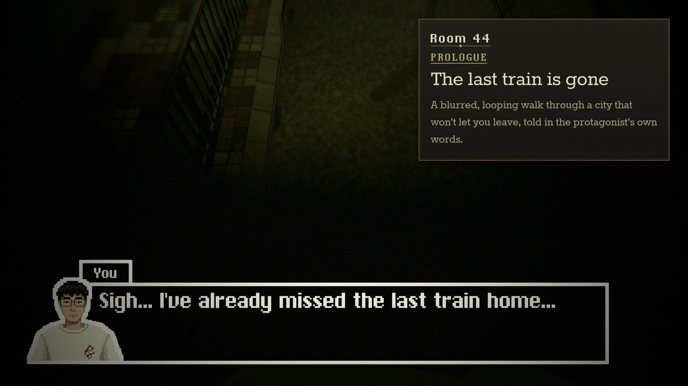

The game opens on its title screen, the café corridor with the pixel **Room 44** logo. Any key starts `VisionFadeEffect`: the title fades to black, then lifts on the protagonist walking along a street with their eyes on the pavement. The walk is scripted at 3 m/s and **loops**: when it reaches the end point it blinks and teleports back to the start, while random blur passes (every 1.5–4 s) and blinks (every 4–10 s) play over the view. Trigger volumes along the way start the monologue (*"Sigh… I've already missed the last train home…"*, *"This time last year I was a fresh graduate…"*, *"Look at me now…"*). When it ends, the street fog rolls in, the loop is released and you wake at the mouth of an alley: *"(This is the street from the flyer.)"*

<a href="github/videos/01_the_last_train.mp4">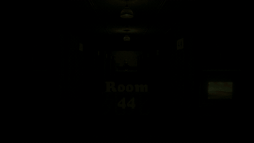</a>

🎬 [`github/videos/01_the_last_train.mp4`](github/videos/01_the_last_train.mp4). Title screen, the start fade, the looping walk with the monologue, then the fog and the corner.

---

## 3. The street and its sound

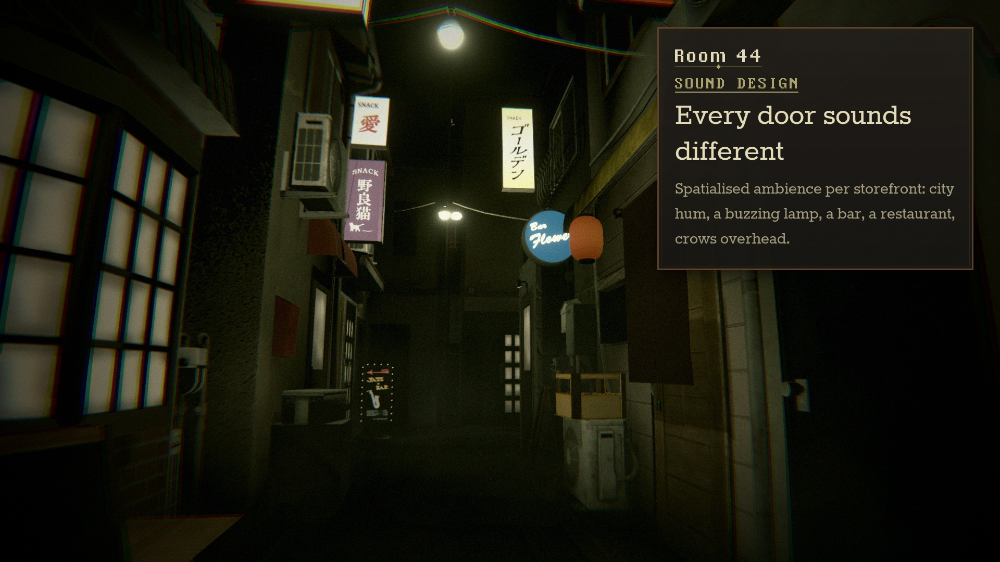

The playable street is a short alley between the main road and the café. Walking back the way you came is blocked by an interaction (*"This is the way I came."*). Every storefront is an interaction point with its own lines: the bar (*"A strong scent of beer and cigarettes…"*), the jazz bar (*"always full even this late"*), the closed izakaya, the restaurant you are underdressed for.

The atmosphere is mostly audio. Each place is a separate 3D `AudioSource`, routed through the master mixer, so the mix changes as you walk:

| Source | Clip | Volume | Notes |
|---|---|---|---|
| Street | `CityAmbience` | 0.175 | looping city hum along the alley |
| Street lamp | `LampBuzzAmbiance` | 0.15 | electrical buzz overhead |
| Bar | `BarAmbience` | 0.3 | voices and glasses behind the door |
| Jazz bar | `JazzAmbience` | 0.1 | muffled band |
| Restaurant | `RestaurantAmbience` | 0.5 | dining room through the wall |
| Crows | `Crow` | 0.5 | one-shot, every 60–100 s at random (`RandomCrow`) |
| Café music | `CafeMusic` ×10 | animated | ten speakers spread through the café |
| Café keyboards | `InternetBrowsingAmbience` | animated | 2D bed of typing and clicks |

Street, lamp and crow sources have Animators with a `Mute` state that fades their volume; the café sources start silent. Stepping through the café doors flips those states, so the street fades out and the café fades in.

<a href="github/videos/02_the_street.mp4">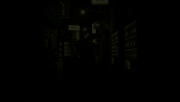</a>

🎬 [`github/videos/02_the_street.mp4`](github/videos/02_the_street.mp4). Environment-only passes through the alley at eye height: the entrance, the lanterns, the jazz bar door, looking back into the fog. Listen with headphones; the audio is the game's own mix at each camera position.

<table><tr><td width="50%">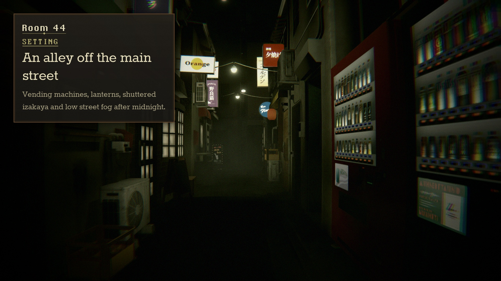</td><td width="50%">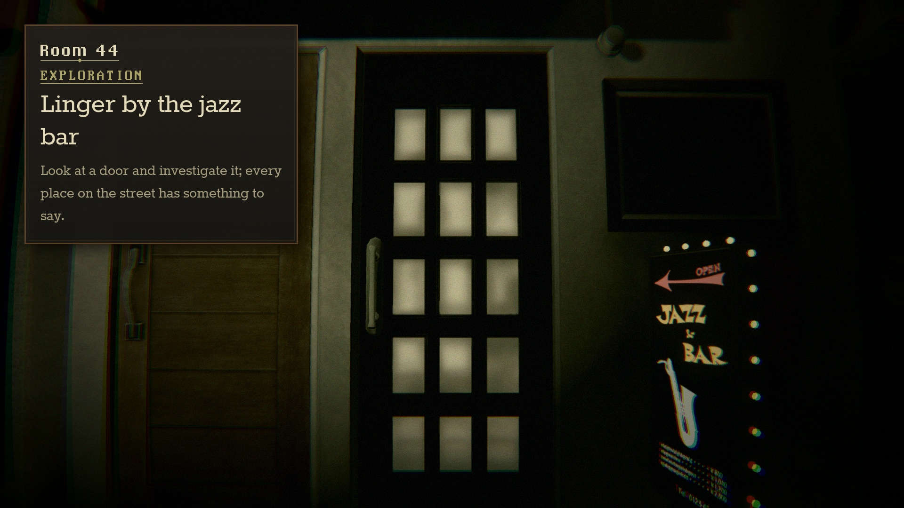</td></tr></table>

---

## 4. Jinja Net Café

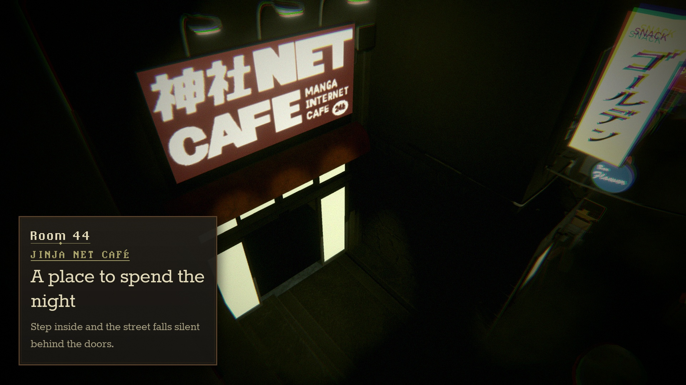

Looking at the café door and pressing `E` asks *"Enter the internet café?"*. Answering yes plays an authored sequence: the camera cuts to a high angle on the **神社 NET CAFE** sign, the sliding doors open, the player walks in, the doors close behind them and the audio states switch. The front door then locks (*"The doors won't budge."*).

Inside are fifty numbered booths in six rows. Every door has its own interaction (*"There seems to be someone inside."*, *"I shouldn't bother the other patrons."*). Room 44 is locked until you speak to the hostess: *"(You notice a distinctive lack of noise in this room.)"*

<a href="github/videos/03_jinja_net_cafe.mp4">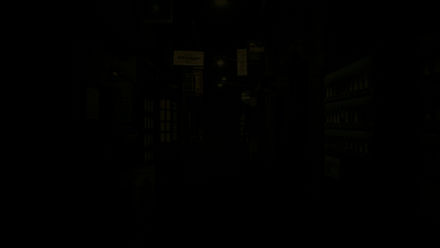</a>

🎬 [`github/videos/03_jinja_net_cafe.mp4`](github/videos/03_jinja_net_cafe.mp4). Walking the alley to the café, the entry prompt and the game's own entrance sequence.

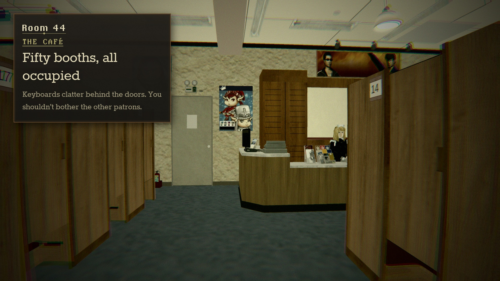

---

## 5. Dialogue: the hostess

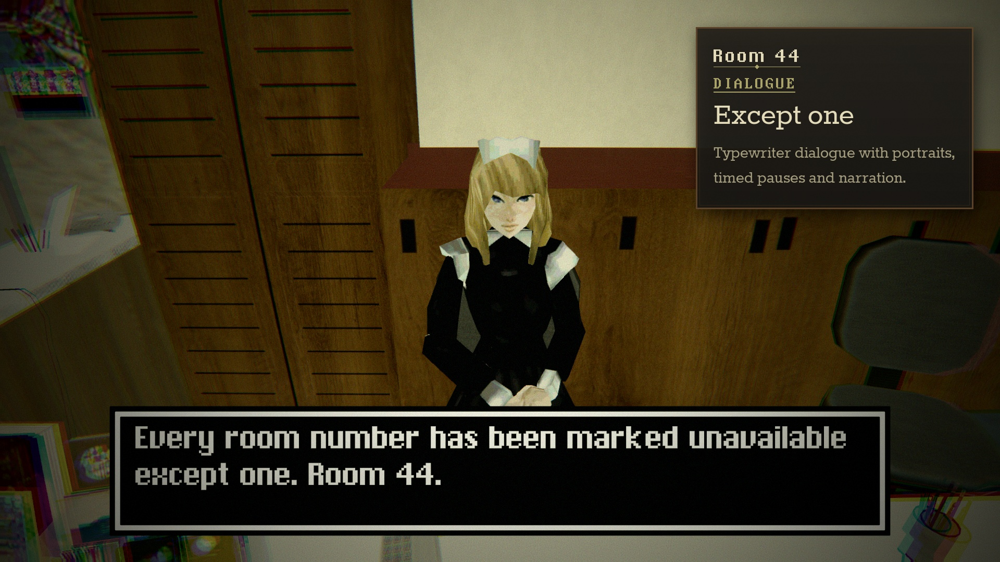

Dialogue is data. A `NormalDialogueSO` is a list of lines with speaker name, portrait, portrait background and type speed. Inside the text, `|` inserts a timed pause and `` ` `` an instant space, which is how *"However|.|.|. there is a minor issue"* gets its hesitation. `E` skips the typing or advances. A `MetaDialogueSO` is a question with answers navigated with `←`/`→` (or `A`/`D`). Lines, answers and dialogue completion each carry a `DialogueEventGroup`: a polymorphic list (`[SerializeReference]`) of events with individual delays:

| Event | Effect |
|---|---|
| `PlaySoundEvent` | one-shot clip on a named `AudioSource` |
| `AnimatorEvent` | trigger / bool / int / float parameter |
| `MoveObjectEvent` | move or rotate a transform (world/local, absolute/additive) over time |
| `ChangeLightEvent` | light colour and intensity over time |
| `ChangeLighting` | scene ambient colour and intensity over time |
| `CameraAnchorEvent` | blend the camera to an anchor, or release it |
| `SetActiveEvent` | enable or disable an object |
| `LoadSceneEvent` | load a scene |

Objects are referenced by name and resolved once at runtime, so the same assets work across scene versions. The hostess's dialogue ends by swapping the locked Room 44 interaction for the real one: *"As you reach for the key, her hand remains on it for half a second too long."*

<a href="github/videos/04_the_hostess.mp4">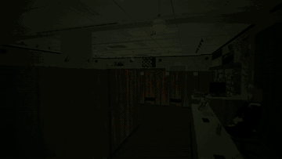</a>

🎬 [`github/videos/04_the_hostess.mp4`](github/videos/04_the_hostess.mp4). The approach to the desk and the key lines: the last room, the computer that only boots into a terminal, the previous customer who left in a hurry, the warning, the key.

---

## 6. Room 44 and the terminal

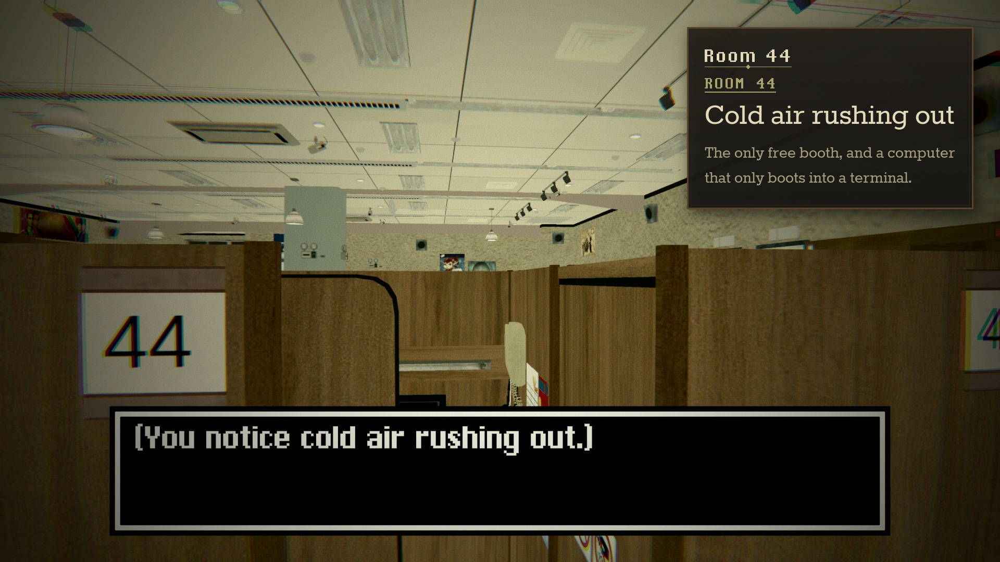

The first look at the door unlocks it (*"The door unlocks with a metallic clunk."*, *"You notice cold air rushing out."*). The second asks *"Enter Room 44?"*. Yes runs a chain of delayed events: the player steps in, turns, sits (`IsSitting`), and the camera blends through two anchors onto the monitor, which switches on the terminal.

<a href="github/videos/05_room_44.mp4">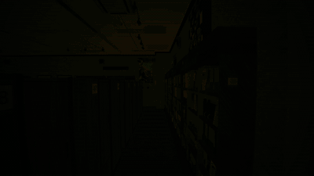</a>

🎬 [`github/videos/05_room_44.mp4`](github/videos/05_room_44.mp4). Down the corridor past rooms 47 to 45, the door, the prompt and the seated camera sequence.

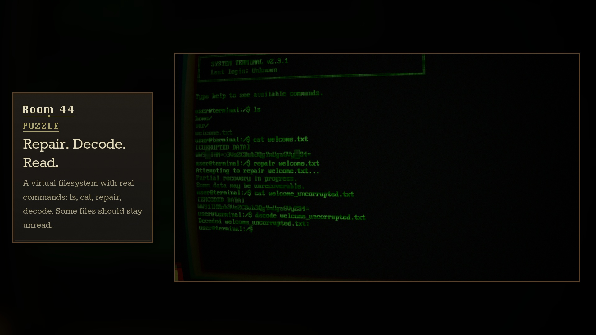

**The shell.** `TerminalManager` reads typed characters from the Input System (`Keyboard.onTextInput`), handles `Enter`, held `Backspace` with acceleration, `Tab` completion, `↑`/`↓` history, `Ctrl+L` and `Ctrl+C`, and dispatches to a `CommandRegistry`. The parser supports aliases (`dir`, `list`, `read`, `show`, `quit`…) and suggests close matches when a file name is wrong.

| Command | What it does | Command | What it does |
|---|---|---|---|
| `help` | List commands, or `help <command>` | `decode` | Base64-decode an encoded file |
| `ls` | List files and folders | `repair` | Fire the file's repair event |
| `cd` | Change directory | `restore` | Recover deleted or hidden files |
| `cat` | Read a file (glitched if corrupted) | `listen` | Listen carefully to the environment |
| `open` | Open a file or folder, firing its event | `remember` | Recall something you have seen before |
| `find` | Search file names across the filesystem | `history` | Show command history |
| `unzip` | Extract an archive | `hint` | Ask for a contextual hint |
| `pwd` · `echo` · `clear` | The usual | `exit` | Leave the terminal |

**The filesystem** is a `FilesystemDefinition` ScriptableObject: directories and files with owner, group, permissions, hidden and locked flags, a file type (text, corrupted, encoded, event trigger), progressive line reveal, and an event fired on read. The Room 44 machine has `/home/user/README.txt` (*"You should not be here."*), `/var/log/system.log` (a boot log from 2003-08-12 that stops at `03:14:??`), and `/welcome.txt`.

**The first puzzle** (spoilers):

1. `cat welcome.txt` prints `[CORRUPTED DATA]` and a glitched string.
2. `repair welcome.txt` fires `evt_repair_welcome.txt`, which removes the file and adds `welcome_uncorrupted.txt`, an **encoded** file.
3. `cat welcome_uncorrupted.txt` shows `[ENCODED DATA]` and a base64 string.
4. `decode welcome_uncorrupted.txt` decodes it and fires `evt_decode_welcome_uncorrupted.txt`.

🎬 [`github/videos/06_the_terminal.mp4`](github/videos/06_the_terminal.mp4). The full first puzzle on the monitor, cropped onto the screen.

**Events and corruption.** `TerminalEventSystem` runs `TerminalEventSO` assets: required and blocking flags, maximum fire counts, typewriter output, files to add or remove, flags to set, a corruption-intensity change, and a `DialogueEventGroup`, so a terminal event can drive anything the dialogue system can. Events can also fire on elapsed time or player hesitation. `CorruptionSystem` scales text glitching, ghost messages (*"she never left"*, *"it knows you're here"*), hallucinated commands, input overwrites, fake kernel panics and terminal talk (*"I've been waiting."*) by an intensity value. The demo's settings enable glitch, ghost messages and terminal talk at a base intensity of 0, ready for events to raise it.

---

## 7. Lights out

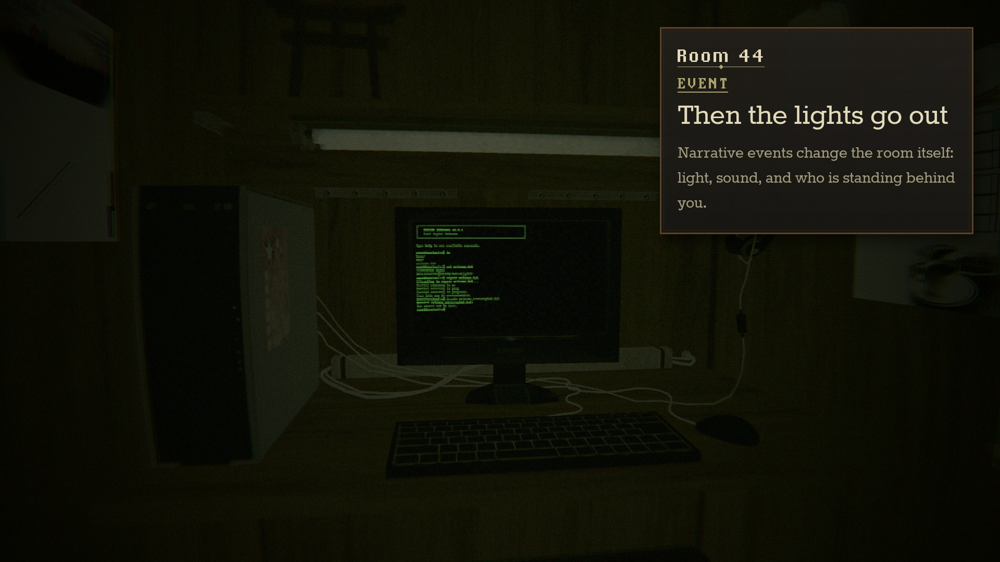

The decoded text reads *"You should not be here."* Two seconds later the decode event drops the ambient light to near-black, disables every café audio source and places the hostess at the booth door. The café's music and keyboard bed stop dead, so the scene goes completely silent. The same event moves a trigger onto the seated player, which starts *"…"* / *"(I should probably go see what happened.)"*; when that dialogue completes, its events switch the terminal off, stand the player up, turn them toward the door, walk them into the doorway and turn them again, straight into the hostess. The terminal ignores keystrokes while any dialogue is on screen, so the scripted sequence can't be doubled by typing a command such as `exit` underneath it.

<a href="github/videos/07_lights_out.mp4">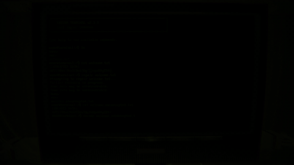</a>

🎬 [`github/videos/07_lights_out.mp4`](github/videos/07_lights_out.mp4). Decode, blackout, *"(I should probably go see what happened.)"*, and who is standing there.

---

## 8. The café after dark

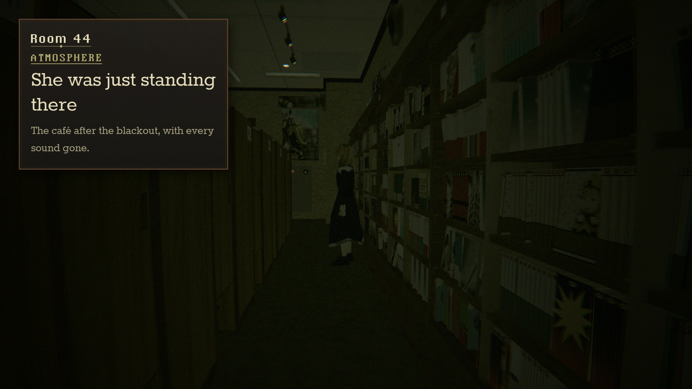

The same rooms after the event, with every ambient source gone: only the terminal glows in Room 44, and the hostess waits in the dark corridor.

<a href="github/videos/08_after_dark.mp4">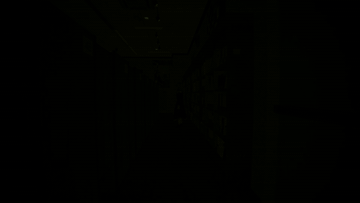</a>

🎬 [`github/videos/08_after_dark.mp4`](github/videos/08_after_dark.mp4). Slow environment passes through the blacked-out café.

---

## 9. Look and feel

- **Post Processing v2** on the player camera: vignette (0.62), lens distortion (25), chromatic aberration (0.37), coloured film grain (0.2), bloom (2) and motion blur, with a colour-grading saturation boost.
- **Pixel typography:** pixChicago for the logo, PxPlus IBM VGA 8x16 for the terminal, and pixel UI frames for dialogue, name plates and prompts.
- **First-person controller:** a `CharacterController` at 4.5 m/s with clamped pitch, re-synced after every scripted camera sequence so control never snaps.

---

## 10. How this media was made

Footage was recorded in the Unity editor at a locked 30 fps (`Time.captureFramerate`) at 1920×1080, with the game's audio rendered offline in sync through `AudioRenderer`, so every clip carries the real mix, including the blackout's silence. Notes on staging:

- **Input was simulated.** The game reads the keyboard directly, so a capture script pressed the game's own buttons for it: starting the title screen, advancing dialogue lines after a fixed hold, choosing *Yes* in prompts, and typing terminal commands through the terminal's own text-input handler. Every scene, sequence, camera move, dialogue line and event in the story clips is the game's own.
- **Walking was puppeted** through the player's own `CharacterController` and `IsMoving` animation, and the player was repositioned off-camera between takes (for example into the Room 44 corridor).
- **Environment passes** (`02_the_street`, `08_after_dark` and most trailer shots) use a free camera inside the playable bounds at eye height, with the player hidden. The after-dark state came from solving the terminal puzzle off-camera. The trailer's hostess, Room 44 door and terminal close-ups are free-camera shots of the real scene with the dialogue UI hidden; the terminal puzzle in them is typed live. The trailer's run through the dark halls is staged: a camera-mounted flashlight, the booth doors slid open by script as the camera passes (the same slide the game uses), and the seated hostess hidden so every booth is empty.
- **Trailer grade and sound:** the trailer and screenshots get an extra olive film grade, with blackout shots lifted slightly so they stay readable. The trailer runs on an original score composed for it (silent through the game's blackout) and a voice-over of its intertitles synthesized with Kyutai Pocket-TTS; the per-scene clips in this document keep the game's own audio.
