

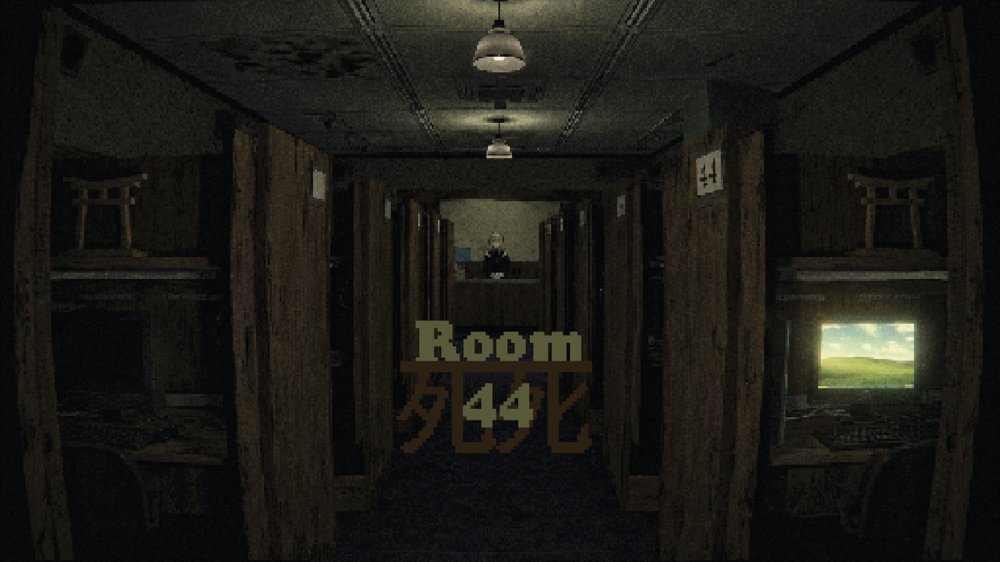

# Room 44

*Every room is taken. Except one.*

**A first-person psychological mystery set in a Japanese manga café after the last train has gone: walk a night street you can hear, talk your way into the only free booth, and get its broken computer to tell you why it's empty.**

<a href="GameplayBreakdown/github/ROOM44_trailer_github.mp4">
  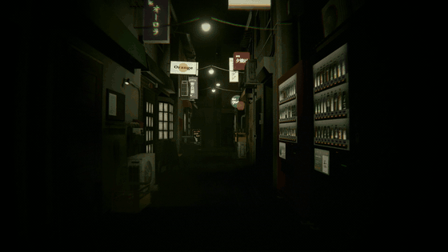
</a>

▶️ **[Watch the trailer (64 s, with sound)](GameplayBreakdown/github/ROOM44_trailer_github.mp4)** · 📖 **[Gameplay breakdown](GameplayBreakdown/GAMEPLAY_BREAKDOWN.md)**

<!-- For a playable trailer WITH SOUND inline: on github.com, edit this file and drag the <=10 MB
     trailer into the editor here; keep the generated user-attachments URL on its own line. -->

---

## About

You missed the last train home. A year out of university and going nowhere, you drift through a narrow alley of shuttered izakaya, a smoky bar and a jazz club that's always full, looking for somewhere to wait for morning. The flyer said there was an internet café a few streets back.

At **Jinja Net Café** every booth is occupied except one. The hostess hands you the key to Room 44, mentions that its computer only boots into a terminal, and asks you to tell her immediately if the machine behaves strangely. The rest happens on that screen, and in the café around it.

  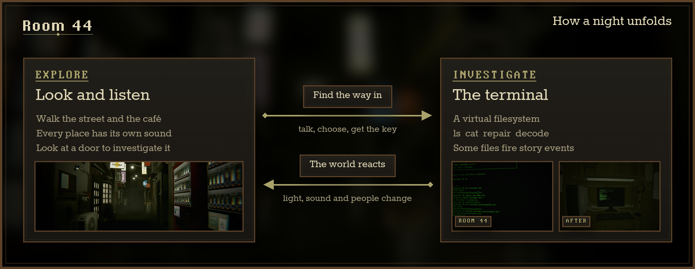

## Features

<table>
  <tr>
    <td width="50%">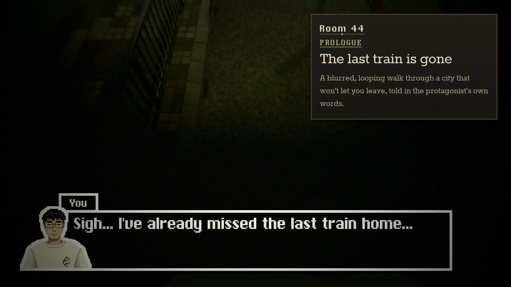</td>
    <td width="50%">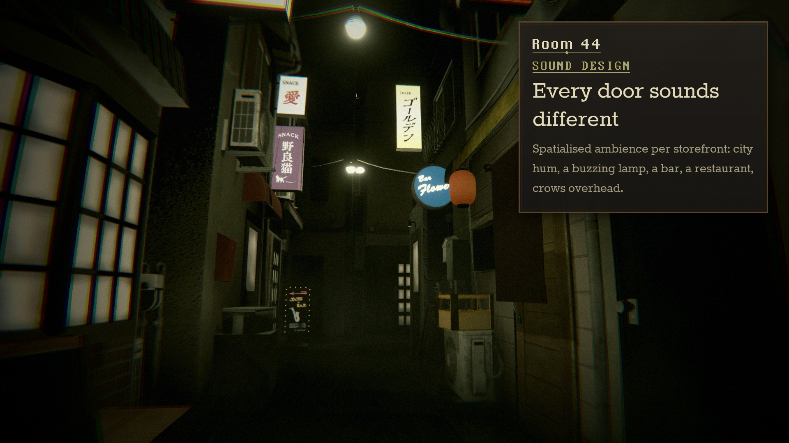</td>
  </tr>
  <tr>
    <td><b>A prologue told in your own words.</b> The game opens on a blurred, blinking walk that loops back on itself while the protagonist talks, then hands you a fog-filled alley.</td>
    <td><b>A street you can hear.</b> Each storefront has its own spatialised source (city hum, a buzzing lamp, a bar, jazz behind a door, a restaurant, crows), so you can walk toward the sounds.</td>
  </tr>
  <tr>
    <td>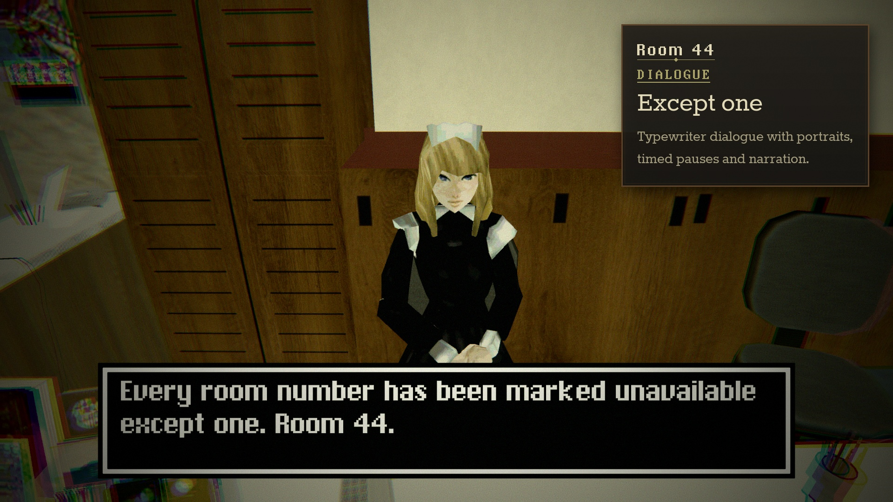</td>
    <td>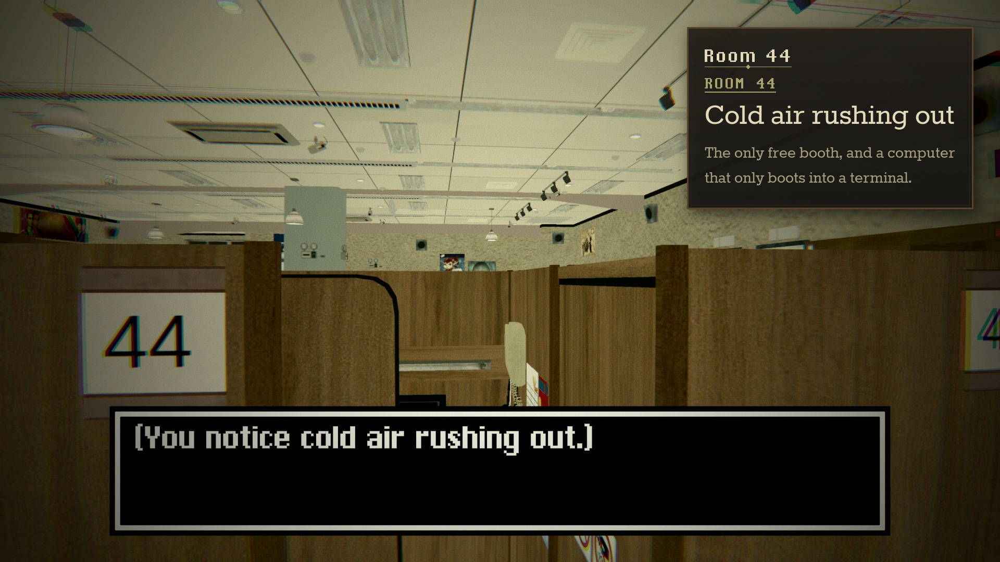</td>
  </tr>
  <tr>
    <td><b>Typewriter dialogue.</b> Portraits, name plates, timed pauses, narration and yes/no choices, all authored as ScriptableObjects with events attached to lines and answers.</td>
    <td><b>Look to interact.</b> Doors and storefronts respond when you're close <i>and</i> looking at them, and scripted camera sequences take over for key moments.</td>
  </tr>
  <tr>
    <td>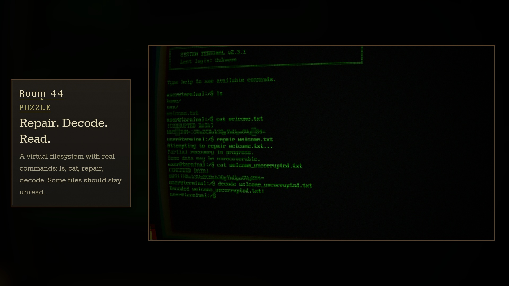</td>
    <td>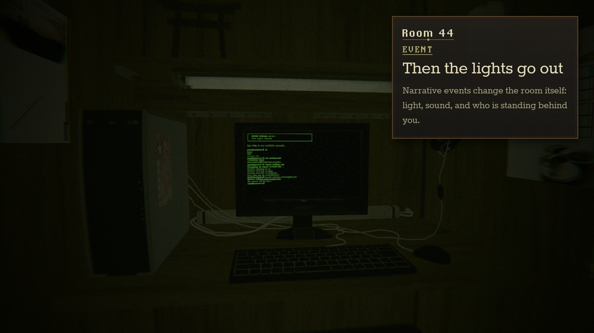</td>
  </tr>
  <tr>
    <td><b>A terminal that answers back.</b> A virtual filesystem with real commands (<code>ls</code>, <code>cat</code>, <code>repair</code>, <code>decode</code>…), corrupted and encoded files, and a corruption system built for ghost messages and glitches.</td>
    <td><b>The room reacts.</b> Reading the wrong file fires narrative events that change ambient light, cut the café's audio and move people around you.</td>
  </tr>
</table>

### Locations

| The street | Jinja Net Café |
|---|---|
| 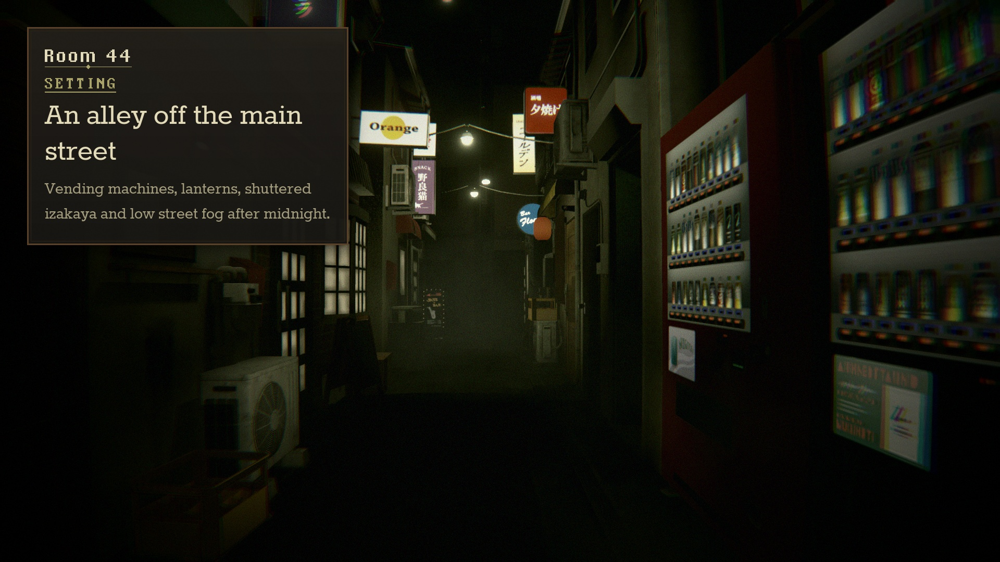 | 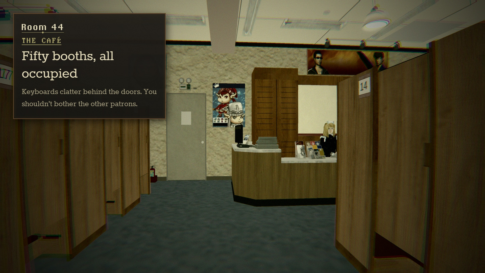 |
| Vending machines, lanterns and low fog in an alley off the main road. | Fifty numbered booths, keyboards behind every door, and a hostess at the desk. |

## The terminal

The Room 44 computer runs a small command shell over a virtual filesystem defined in a ScriptableObject.

| Command | What it does | Command | What it does |
|---|---|---|---|
| `help` | List commands, or `help <command>` | `decode` | Decode an encoded or corrupted file |
| `ls` | List files and folders | `repair` | Attempt to repair a corrupted file |
| `cd` | Change directory | `restore` | Restore deleted or hidden files |
| `cat` | Read a file | `listen` | Listen carefully to the environment |
| `open` | Open a file or folder (fires its event) | `remember` | Recall something you have seen before |
| `find` | Search files by name | `history` | Show command history |
| `unzip` | Extract an archive | `hint` | Ask for a contextual hint |
| `pwd` · `echo` · `clear` | The usual | `exit` | Leave the terminal |

## Controls

| On foot | | Dialogue & terminal | |
|---|---|---|---|
| Move | `W` `A` `S` `D` | Advance dialogue / skip typing | `E` |
| Look | Mouse | Choose an answer | `←` `→` or `A` `D`, confirm with `E` |
| Interact (while looking at it) | `E` | Run a command | type, then `Enter` |
| | | Autocomplete · history | `Tab` · `↑` `↓` |
| | | Clear screen · cancel | `Ctrl+L` · `Ctrl+C` |

## Under the hood

- **Dialogue system.** `NormalDialogueSO` (lines with speaker, portrait, type speed and `|` pause markers) and `MetaDialogueSO` (question + answers) run through a singleton `DialogueManager`; every line, answer and completion carries a `DialogueEventGroup` of polymorphic `[SerializeReference]` events: play sound, animator parameter, move object, change light, change ambient lighting, camera anchor, set active, load scene.
- **Interaction points.** `InteractionPoint` combines a trigger volume with a look rectangle (a ray–plane test from the screen centre), shows a hint, and walks through an ordered or random sequence of dialogue entries.
- **Camera control.** `CameraController` blends the first-person camera to authored anchors for cutscenes and dialogue, then hands control back to `FirstPersonController`.
- **TerminalHorror.** `TerminalManager` reads keyboard text through the new Input System and dispatches to a `CommandRegistry` (aliases, fuzzy "did you mean" suggestions). The `VirtualFileSystem` supports hidden, locked, corrupted, encoded and event-trigger files. `TerminalEventSystem` fires data-driven events on reads, directory entry, time and hesitation, gated by flags and fire counts. `CorruptionSystem` provides glitching, ghost messages, hallucinated commands and fake crashes scaled by an intensity value, and `TerminalSaveSystem` persists the session as JSON.
- **Audio.** Every location is a set of 3D `AudioSource`s routed through a master mixer; Animator-driven mute states cross-fade the street and the café when you step through the doors.
- **Look.** Post Processing v2 stack (vignette, lens distortion, chromatic aberration, coloured grain, bloom, motion blur) plus a pixel-font UI.

Gameplay scripts live in [`Assets/Scripts/`](Assets/Scripts): `DialogueSystem/` (dialogue, interaction, camera), `TerminalHorror/` (the computer), and the first-person controller and intro effect at the top level.

## Getting started

1. Install [Git LFS](https://git-lfs.com/) and clone the repository (three large scene models are stored with LFS).
2. Open the project with **Unity 6000.3.10f1** (Built-in Render Pipeline, Post Processing v2, Input System with both input backends enabled).
3. Open `Assets/_Recovery/0.unity` and press **Play**, then any key on the title screen.

## Media

All footage, audio and screenshots were captured in-engine from the actual game.

- 🎬 [Trailer](GameplayBreakdown/github/ROOM44_trailer_github.mp4) and per-scene clips in [`GameplayBreakdown/github/videos`](GameplayBreakdown/github/videos). Each clip also plays inline as an animated preview in the [gameplay breakdown](GameplayBreakdown/GAMEPLAY_BREAKDOWN.md) ([`previews/`](GameplayBreakdown/github/previews))
- 🖼️ Store-style screenshots in [`GameplayBreakdown/screenshots`](GameplayBreakdown/screenshots)
- 📖 A detailed design breakdown in [`GameplayBreakdown/GAMEPLAY_BREAKDOWN.md`](GameplayBreakdown/GAMEPLAY_BREAKDOWN.md)

## Credits

- **Trailer sound:** an original score composed for the trailer; the voice-over was synthesized with Kyutai Pocket-TTS (weights under CC-BY-4.0). The per-scene clips keep the game's own audio.
- **Fonts:** PxPlus IBM VGA 8x16 (VileR, [The Ultimate Oldschool PC Font Pack](https://int10h.org/oldschool-pc-fonts/), CC BY-SA 4.0), Rokkitt (Vernon Adams, SIL Open Font License), pixChicago.
- **Third-party art and asset packs** in `Assets/Imports/`, `Assets/Plugins/` and `Assets/Prefabs/` (city buildings, Japanese internet café, Japanese street at night, characters, AllSkyFree skyboxes, CRT-Free) belong to their respective authors and are covered by their own licences.
